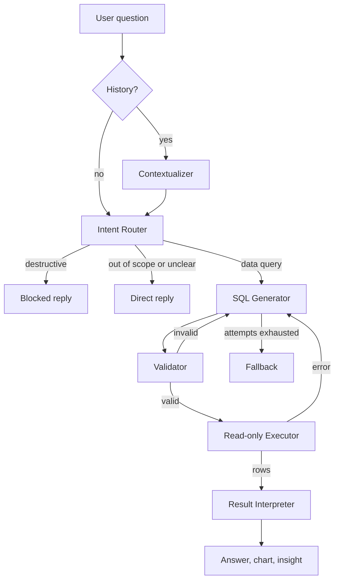

# Nawaloka Hospital NL2SQL Platform

Ask questions about hospital data in plain English and get back results, charts and short insights, without writing SQL.

I built this to explore how far a small multi-agent pipeline can go on a realistic 12-table hospital database (about 50,000 patients and 200,000 appointments) while keeping generated SQL safe. A router, a SQL generator, a result interpreter and a fallback agent are wired together with LangGraph, and every step is traced.

## Architecture



Design notes, real query traces and a discussion of what I would change for production are in [report/design_notes.md](report/design_notes.md).

## Setup

Requires Python 3.14 and [uv](https://docs.astral.sh/uv/).

```
uv sync
copy .env.example .env
```

Fill in `.env`:

| Variable | Purpose |
|---|---|
| GROQ_API_KEY | LLM provider key |
| DATABASE_URL | Postgres connection string |
| LANGFUSE_SECRET_KEY, LANGFUSE_PUBLIC_KEY, LANGFUSE_BASE_URL | Optional tracing |

Load the data and check the database:

```
uv run python scripts/load_dump.py path/to/medicore_data.sql
uv run python scripts/inspect_db.py
```

## Run

| Command | What it does |
|---|---|
| `uv run nawaloka` | Check configuration and environment |
| `uv run python scripts/ask.py "your question"` | Run the NL2SQL engine only |
| `uv run python scripts/run_pipeline.py` | Run 10 sample questions through all agents and write traces |
| `uv run streamlit run src/nawaloka/app.py` | Dashboard and Ask tabs |
| `uv run pytest -q` | Unit tests |

Example questions to try are in [sample_questions.md](sample_questions.md).

With Docker, the app runs behind nginx with a login. Create the login once, then start the stack:

```
printf "admin:%s\n" "$(openssl passwd -apr1)" > nginx/.htpasswd
docker compose up --build
```

then open http://localhost and sign in. Port 8501 is not published, so nginx is the only way in.

## Deployment

Pushes to `master` run the tests, build the image into GitHub Container Registry and deploy it to EC2 over SSH (`.github/workflows/deploy.yml`). The server keeps its own `.env` and `nginx/.htpasswd`, which are never committed. The deploy needs the `EC2_HOST`, `EC2_USER` and `EC2_SSH_KEY` secrets in the GitHub `production` environment.

## Configuration

Settings live in `config/params.yaml` and model names in `config/models.yaml`. Secrets live only in `.env`.

## Safety

- The router stops requests to change data before any SQL is generated.
- Generated SQL is parsed with sqlglot. Only one SELECT is allowed, DML and DDL are blocked, unknown tables and columns are rejected, and a row limit is added.
- Queries run in a read-only transaction with a statement timeout.
- Users see friendly messages, never raw SQL errors.
- Use a read-only database role for `DATABASE_URL` in production.

## Project layout

```
config/            params.yaml, models.yaml
scripts/           database loading, inspection and run scripts
src/nawaloka/
  agents/          router, contextualizer, interpreter, fallback, orchestrator
  engine/          prompt builder, generator, validator, engine
  db/              engine, query runner, schema introspection
  dashboard/       panels, charts, service
  app.py           Streamlit UI
  observability.py LangFuse and token tracking
traces/            sample pipeline traces
report/            design notes
tests/             unit tests
```
