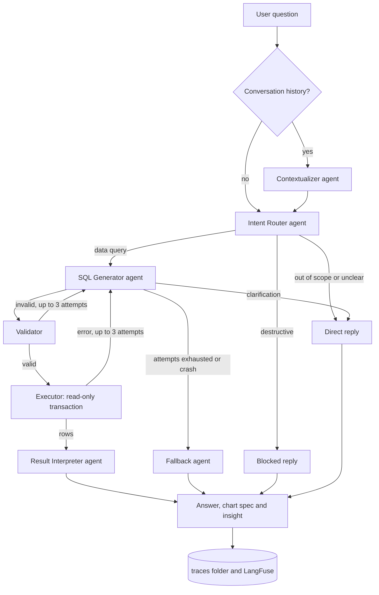

# Design Notes: Multi-Agent NL2SQL Platform

## 1. System Architecture

The pipeline has four LLM agents (Contextualizer, Intent Router, SQL Generator, Result Interpreter) plus a Fallback agent. They exchange typed dataclass messages (`RouterMessage`, `EngineResult`, `Interpretation`, `StepTrace`, `PipelineResult`) and are wired together with LangGraph. The validator and executor are plain code, not LLM calls. The schema in the SQL prompt is read from the live database, so nothing is hardcoded. Every LLM call goes to Groq (`openai/gpt-oss-20b`).

## 2. Query Traces

All figures come from the JSON files in `traces/`.

### Trace A: simple query

| Field | Value |
|---|---|
| Question | How many patients are registered? |
| SQL | `SELECT COUNT(*) AS total_registered_patients FROM patients LIMIT 500` |
| Validation | Passed: one SELECT, known table, LIMIT appended by the validator |
| Output | "There are 50,000 patients registered in the system." |
| Timing | router 15,517 ms, sql_generator 109,146 ms, interpreter 991 ms, total 126,524 ms |
| Tokens | 3,259 in, 132 out |

The query itself is trivial, but this was the slowest run in the set. The next 9 queries in the same batch took between 1.6 and 33 s, so the 109 s SQL generation step is an outlier. The router call in this run was also slow (15 s against 0.3 to 2.6 s later). My explanation is provider rate limiting on the free Groq tier, since about 2,700 of the roughly 3,300 input tokens are the schema. I did not confirm this from the provider's response headers, so it is a likely cause and not a measured one.

### Trace B: complex query

| Field | Value |
|---|---|
| Question | What are the top 5 revenue-generating departments? |
| SQL | `SELECT d.department_name AS department, SUM(b.net_amount) AS total_revenue FROM billing_invoices AS b JOIN admissions AS a ON b.admission_id = a.admission_id JOIN departments AS d ON a.department_id = d.department_id GROUP BY d.department_name ORDER BY total_revenue DESC LIMIT 5` |
| Validation | Passed: three known tables, all columns resolved |
| Output | Anesthesiology $326.5M, Orthopedics $282.6M, ENT $271.7M, Urology $267.9M, Pulmonology $253.6M |
| Timing | router 318 ms, sql_generator 2,606 ms, interpreter 311 ms, total 3,243 ms |
| Tokens | 3,412 in, 269 out |
| Chart | Bar chart with title and axis labels, validated against the result columns |

The model found the join path invoice, admission, department using the foreign keys in the prompt. There is one limitation I noticed when reviewing the trace. `billing_invoices.admission_id` is nullable, so invoices with no admission (for example outpatient billing) are silently excluded from department revenue. The validator cannot catch this because the query is valid. It would need a business rule in the prompt or a question back to the user.

### Trace C: failed query

| Field | Value |
|---|---|
| Question | Show surgeon salaries by blood type |
| SQL | none generated |
| Validation | not reached |
| Output | "I couldn't find any salary information for surgeons in the available tables. Could you specify another metric or provide the relevant table?" |
| Status | clarification |
| Timing | router 465 ms, sql_generator 954 ms, total 1,425 ms |
| Tokens | 3,362 in, 93 out |

The model saw that no salary column exists and asked for clarification instead of inventing one. The user gets a plain message, never a SQL error. A second failing case in the same session was an average over `lab_orders.result_value`, which is a text column. The model again answered with a clarification, and this call took 42 s in the SQL step.

The fallback agent and the retry path were not triggered in any live run. In these runs the model either produced valid SQL or asked for clarification. Those paths are covered by unit tests with mocked agents (`tests/test_pipeline.py`), and the live behaviour of the fallback agent is untested.

## 3. Lessons Learned and Production Considerations

### What the traces showed

The most useful lesson is that syntactic validation is not semantic validation. The first full run passed every check and still gave two wrong answers. "Show monthly admissions for the last 6 months" returned no rows, because the model used today's date while the data ends on 2024-12-31. "Which doctors have the highest no-show rates?" returned raw no-show counts rather than rates. Both queries were safe, valid and executed cleanly.

Both fixes were prompt changes. The SQL generator prompt went through three versions. Version one contained table names, types, keys and sample rows. Version two adds the minimum and maximum of every date column, read from the live database, plus a rule that relative periods are anchored to the latest date in the data. After the change the same question returned July to December 2024. Version three added a rule that rates and percentages must be ratios, and the no-show question then returned rates such as 14.7% for the top doctor. The router prompt had a smaller problem. For destructive requests it returned free text such as "I'm sorry, but I can't help with that", which is unclear to a user, so the pipeline now returns one standard read-only message. The interpreter prompt asks for a chart specification, and the code then checks that the columns exist and that the y column is numeric, because the model sometimes picks a poor x axis (it chose `doctor_id` rather than the doctor name). It also produced a title typo, "Paymentsby Method", which the checks cannot catch.

What I would do differently: write a small evaluation set of questions with known correct answers at the start. I found the date and rate problems by reading output by hand, which does not scale. I would also store the number of retry attempts in the trace, since that is currently only logged.

### Scaling to high query volume

The traces show where the cost is. A data question uses about 3,400 input tokens and about 250 output tokens, and roughly 80 percent of the input is the schema. At 10,000 queries that is about 34 million input tokens. The measured latency range was 1.4 s to 127 s, and the worst cases appear to come from rate limits. The steps I would take, in order of value:

1. Cache answers by normalised question text, so repeated dashboard-style questions never reach the model.
2. Send only the relevant tables to the SQL generator, chosen by a cheap retrieval step, which cuts the biggest cost.
3. Use a paid tier or several keys with a request queue and backoff, instead of relying on a free tier.
4. Run workers behind a queue, use a connection pool, and send read traffic to a replica. The 15 s statement timeout and 500 row cap already protect the database.
5. Sample traces in LangFuse instead of logging every call, and keep the local JSON traces only for debugging.

The dashboard panels already avoid the model for their SQL and only call it for the insight text, which is a pattern worth keeping for high-traffic views.

### Role-based access control

This is not implemented. The design I would use has three layers. First, a separate Postgres role per user group with access only to approved views, so that the database enforces the rules. Second, Postgres row-level security where staff should see only their own department. Third, the validator already takes the schema as an argument and rejects unknown tables and columns, so passing it a role-filtered schema gives per-role table and column control, with the same filtered schema used to build the prompt. Patient contact fields such as email and phone should be masked in views for roles that do not need them. The `traces/` and LangFuse data contain real question text and sample rows, so access to them must be restricted as well.

### SQL injection and unsafe model output

The model output is treated as untrusted input. Current protections: sqlglot parses the query and only a single SELECT or set operation is accepted; any insert, update, delete, DDL, command or `INTO` is blocked; a list of dangerous functions such as `pg_sleep` and `pg_read_file` is blocked; unknown tables and columns are rejected; a LIMIT is added when missing; the query runs inside a read-only transaction with a statement timeout; and the router stops destructive requests before any SQL is generated. User text never gets concatenated into SQL, and the dashboard uses bind parameters for dates.

Known gaps. The function block list is a deny list, not an allow list, so a function I did not think of would pass. The database user in `DATABASE_URL` should be a dedicated read-only role, but in my setup it is the project owner, so the read-only transaction is the only hard barrier. Expensive but valid queries, such as large cross joins, are limited only by the timeout. Sample rows put database content into the prompt, so a malicious value stored in a table could try to steer the model; the rows are truncated, but this is a mitigation and not a fix.

### Summary

The system covers schema-aware prompts, a validator that blocks destructive SQL, retries with clarification, multi-agent orchestration with timing and token traces, a five-panel dashboard, and multi-turn follow-ups. The main weaknesses are semantic errors that no validator can see, dependence on a rate-limited provider, and access control that is still only designed.
